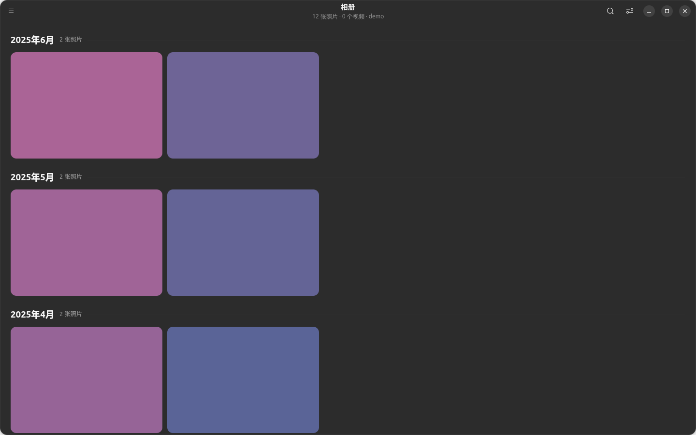
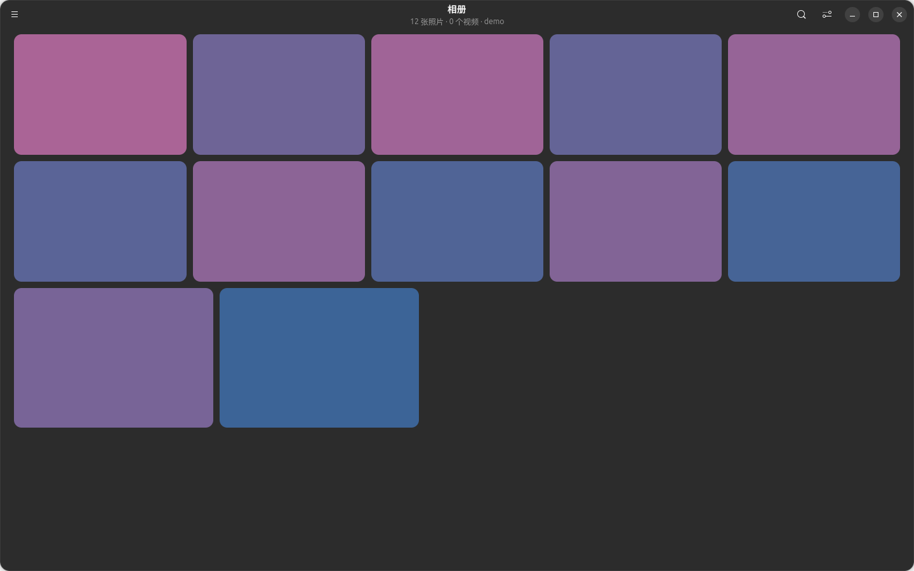
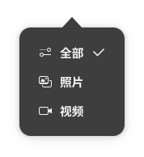
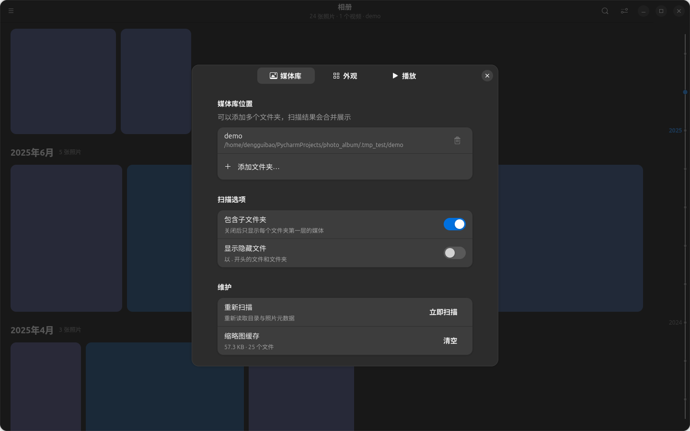
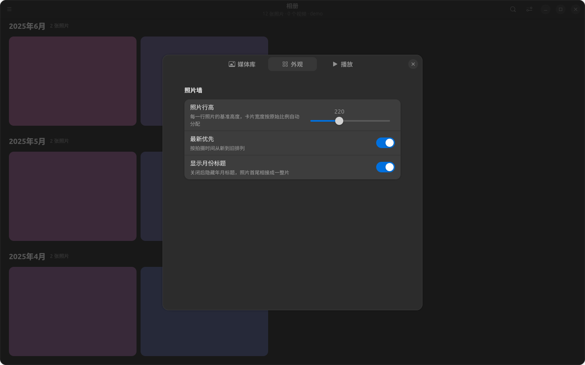
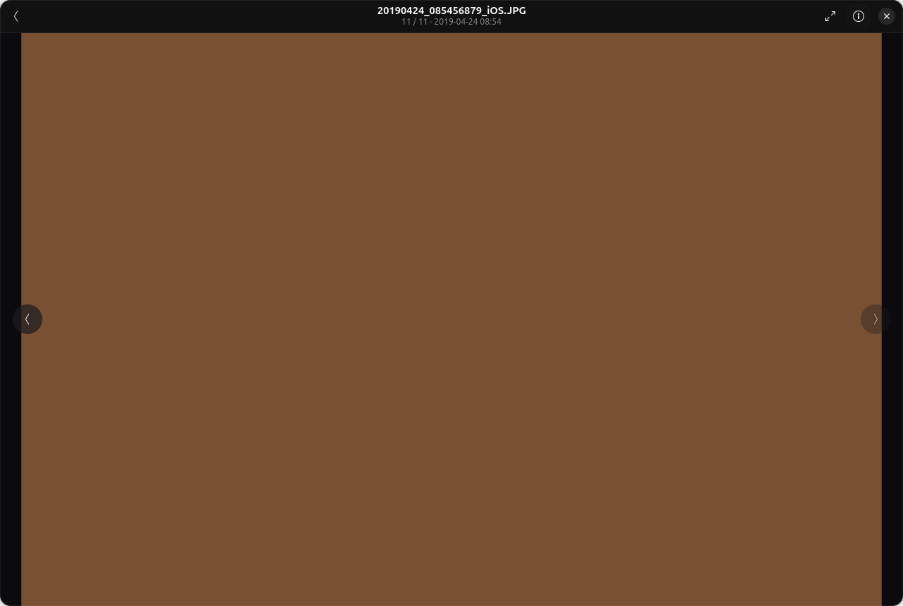
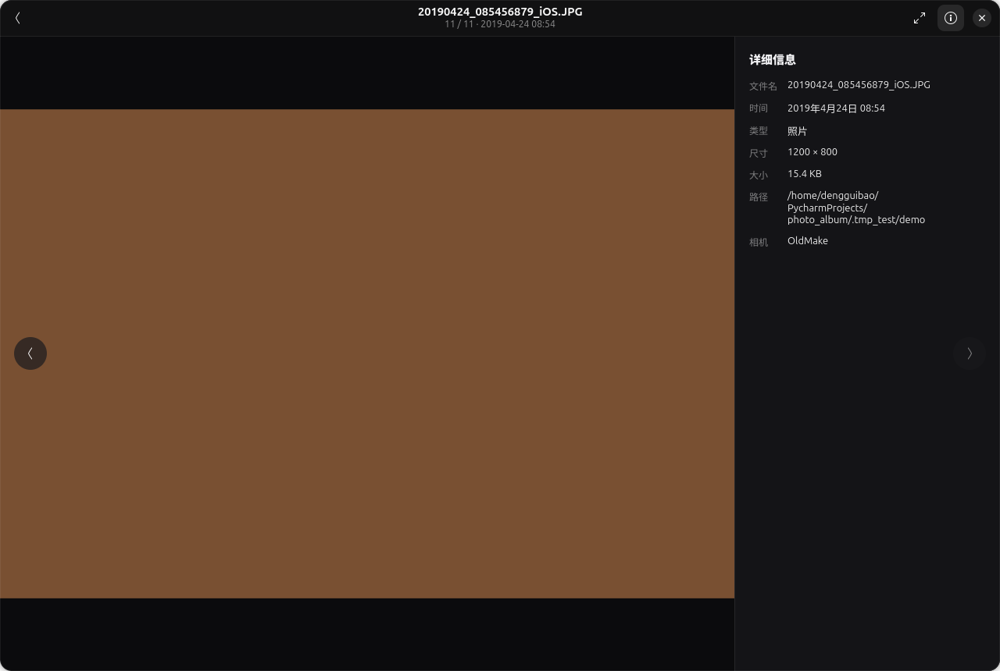
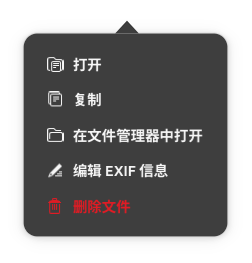
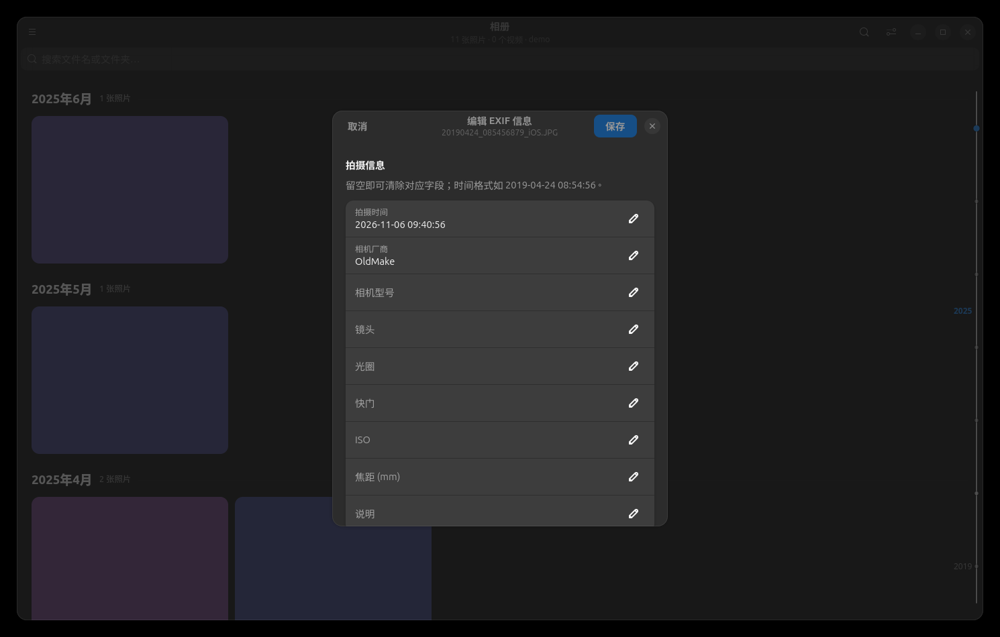

# 相册 · Photo Album

一个面向 Linux 的本地照片 / 视频浏览器，使用 **Python + PyGObject + GTK4 + libadwaita** 编写。
界面参考 Windows 11「照片」：圆角等高行照片墙、EXIF 信息、视频播放与右键删除。
支持配置多个媒体库目录，也支持关闭月份标题，让所有照片首尾相接成一整片连续照片墙。



## 功能

- **等高行照片墙**：按拍摄年月分组；每组内照片按原始宽高比排成若干行，同一行高度一致，
  整行铺满可用宽度；卡片圆角裁切、悬停高亮、键盘焦点环；视频卡片显示播放按钮与时长。
- **渐进加载**：打开应用直接进入相册，扫描结果按批次出现在照片墙中，
  顶部显示「正在加载 x/y…」，不需要等待整个媒体库扫描完成；已加载的缩略图会复用。
- **月份标题可隐藏**：在「偏好设置 → 外观」关闭「显示月份标题」后，照片不再被标题分隔，
  所有卡片首尾相接、跨月份连续成行，形成一整片照片墙。
- **多个媒体库位置**：可以添加任意多个文件夹，扫描结果合并展示；支持增删、去重，
  多个照片目录或移动硬盘都可以放进同一个相册。
- **时间轴暂时停用**：时间轴功能当前关闭，照片墙使用完整宽度；实现保留在
  `timeline.py`，以后将 `config.py` 的 `FEATURE_TIMELINE` 改为 `True` 即可恢复。
- **右键菜单 / 复制 / EXIF 编辑**：右键可打开、在文件管理器中显示、把**真实文件复制到剪贴板**
  （可直接在文件管理器中粘贴），或编辑照片的 EXIF（拍摄时间、相机、镜头、光圈、
  快门、ISO、焦距、说明）；视频不提供 EXIF 编辑。删除默认移到系统回收站
  （失败时可选择永久删除），并即时刷新照片墙；删除文件并清理缩略图缓存后
  只做**原地增量重排**，后面的照片直接向前补位，当前滚动位置保持不变，
  不会先跳到顶部再跳回来。选中卡片后按 `Delete` 也可删除。
- **可配置媒体库**：默认目录 `~/OneDrive/Pictures`（不存在时使用 `~/Pictures`），
  可在偏好设置中管理多个位置，并开关「包含子文件夹」「显示隐藏文件」。
- **丰富的格式支持**：JPEG / PNG / GIF / WebP / TIFF / HEIC / HEIF / AVIF，
  MP4 / MOV / MKV / WebM / AVI 等；读取 EXIF 拍摄时间、方向、相机、光圈、快门、ISO。
  HEIC/HEIF 使用 libheif 解码，可正确处理 iPhone 的 HEVC grid 图片、编辑后的裁剪和方向。
- **日期识别**：EXIF 与文件名中的日期一致时优先使用 EXIF（通常更精确）；
  两者矛盾或没有 EXIF 时优先使用文件名日期（例如 `20190424_085456879_iOS.PNG`、
  `PXL_20240101_123456789.jpg`）；两者都没有才退回文件修改时间，
  避免 OneDrive/复制操作把修改时间当成拍摄时间。
- **缩略图懒加载**：只在可视区域附近生成，滚出后释放纹理；磁盘缓存复用，
  数千张照片的目录也能较快打开。
- **全屏查看器**：滚轮 / 双指缩放、拖动平移、双击 200%、左右键翻页、`I` 查看信息、
  `F11` 全屏；视频使用 GStreamer 播放，支持自动播放与暂停。
- **搜索与筛选**：按文件名 / 文件夹路径搜索；标题栏右侧的筛选图标可选择
  「全部 / 照片 / 视频」，图标会随当前模式变化；支持按时间正序 / 倒序。
- **细节**：深浅色主题自适应、拖放文件夹到窗口即可添加位置、窗口大小与设置自动保存。

不显示月份标题时的连续照片墙：



筛选图标和点击后弹出的菜单：



| 媒体库位置 | 外观设置 |
| --- | --- |
|  |  |

| 查看器 | EXIF 信息面板 |
| --- | --- |
|  |  |

卡片右键菜单与 EXIF 编辑：

| 右键菜单 | 编辑 EXIF |
| --- | --- |
|  |  |

## 环境要求

这个项目依赖系统提供的 GTK/PyGObject，不推荐用 pip 单独安装 PyGObject。

### 必须满足

| 组件 | 最低要求 | 用途 |
| --- | --- | --- |
| Python | 3.10 | 运行应用 |
| PyGObject | 3.42 | GObject Introspection 绑定 |
| GTK | 4.10 | `Gtk.FileDialog`、GTK4 控件 |
| libadwaita | 1.5 | `Adw.Dialog`、`Adw.PreferencesDialog`、`Adw.AlertDialog` |
| Pillow | 9 | 图片解码、缩略图 |
| Pango / Cairo | 随 GTK 提供 | 自绘控件与缩略图 |

### 可选功能依赖

| 组件 | 用途 | 缺失时 |
| --- | --- | --- |
| GExiv2（推荐） | 读取/编辑 EXIF | 仍能浏览，但 EXIF 编辑不可用，部分日期退回文件名/mtime |
| libheif 工具（推荐） | `heif-convert` / `heif-info`，解码 HEIC/HEIF/AVIF | HEIC 可能无法显示；ffmpeg 对部分 iPhone HEIC 支持不完整 |
| ffmpeg / ffprobe（推荐） | 视频元数据、视频缩略图、部分图片兜底解码 | 视频时长/缩略图可能缺失 |
| GStreamer GTK4 插件和编解码器 | `Gtk.Video` 播放视频 | 视频可能无法播放 |
| ImageMagick | 没有 libheif 时的 HEIC 备选解码 | HEIC 兜底能力下降 |
| GVfs | 移到回收站 | 回收站不可用时只能永久删除 |
| xdg-utils | 在文件管理器中显示 | 该菜单项可能无效 |
| adwaita-icon-theme | 界面图标 | 图标可能缺失 |

> `.deb` 只适用于 Debian/Ubuntu 系。Fedora、Arch、openSUSE、NixOS 等请从源码运行
> `./photo-album`，按下面的发行版命令安装依赖；不要直接安装 `.deb`。

### 版本支持范围

应用使用了 GTK `Gtk.FileDialog`（GTK 4.10+）和 libadwaita 的
`Adw.Dialog` / `Adw.PreferencesDialog`（libadwaita 1.5+），因此：

| 发行版 | 情况 |
| --- | --- |
| Ubuntu 24.04 LTS、26.04 LTS | 可用（26.04 已验证） |
| Ubuntu 22.04 LTS | 不自带 GTK 4.10 / libadwaita 1.5，需要 Flatpak、Nix 或自行升级依赖 |
| Debian 13 | 可用 |
| Debian 12 | GTK 4.8 / libadwaita 1.2，不满足最低版本 |
| Fedora 40+ | 可用 |
| Arch Linux | 滚动版可用 |
| openSUSE Tumbleweed | 可用 |
| NixOS | 可用，需要按 Nix 方式打包 Python/GTK 依赖 |

如果发行版版本较老，推荐使用 Flatpak 或 Nix 隔离运行，而不是强行混装系统 GIR。

### Debian / Ubuntu

适用于 Ubuntu 24.04+、Debian 13+；Ubuntu 26.04 已验证：

```bash
sudo apt install python3-gi python3-gi-cairo gir1.2-gtk-4.0 gir1.2-adw-1 \
    python3-pil gir1.2-gexiv2-0.10 libheif-examples ffmpeg imagemagick \
    gstreamer1.0-gtk4 gstreamer1.0-plugins-good gstreamer1.0-plugins-bad \
    gstreamer1.0-libav gvfs xdg-utils adwaita-icon-theme
```

注意 Ubuntu 26.04 的包名是 `gir1.2-adw-1` 和 `gir1.2-gexiv2-0.10`，
不是 `gir1.2-adwaita-1` / `gir1.2-gexiv2`。

### Fedora 40+

```bash
sudo dnf install python3-gobject gtk4 libadwaita python3-pillow gexiv2 \
    libheif-tools ffmpeg-free ImageMagick gstreamer1-plugin-gtk4 \
    gstreamer1-plugins-good gstreamer1-plugins-bad-free \
    gstreamer1-plugins-good-extras gvfs xdg-utils adwaita-icon-theme
```

需要更多视频/HEVC 编解码器时，可从 RPM Fusion 安装 `ffmpeg` 和对应 GStreamer 插件。

### Arch Linux

```bash
sudo pacman -S python-gobject gtk4 libadwaita python-pillow gexiv2 libheif \
    ffmpeg imagemagick gst-plugin-gtk4 gst-plugins-good gst-plugins-bad \
    gst-libav gvfs xdg-utils adwaita-icon-theme
```

### openSUSE Tumbleweed

大致需要：

```bash
sudo zypper install python3-gobject python3-gobject-Gdk python3-Pillow \
    gtk4 libadwaita-1-0 typelib-1_0-Adw-1 gexiv2 typelib-1_0-GExiv2-0_10 \
    libheif-tools ffmpeg ImageMagick gstreamer1-plugin-gtk4 \
    gstreamer1-plugins-good gstreamer1-plugins-bad gstreamer1-plugins-libav \
    gvfs xdg-utils adwaita-icon-theme
```

openSUSE Leap 的 GTK/libadwaita 版本可能低于要求，建议用 Tumbleweed 或容器/Flatpak。

### 检查当前系统版本

```bash
python3 - <<'PY'
import gi
for namespace, version in (("Gtk", "4.0"), ("Adw", "1"), ("GExiv2", "0.10")):
    try:
        gi.require_version(namespace, version)
        module = __import__("gi.repository", fromlist=[namespace])
        obj = getattr(module, namespace)
        print(namespace, getattr(obj, "get_major_version", lambda: "?")(),
              getattr(obj, "get_minor_version", lambda: "?")())
    except Exception as error:
        print(namespace, "missing:", error)
PY
```

只要 GTK >= 4.10、libadwaita >= 1.5、Python >= 3.10，并且 PyGObject/Pillow 可用，
就可以从源码运行；发行版包名差异不影响程序本身。

可以直接运行依赖检查脚本：

```bash
python3 packaging/check_dependencies.py
```

## 运行

```bash
# 仓库内直接运行（推荐）；默认媒体库为 ~/OneDrive/Pictures
./photo-album

# 指定一个或多个照片目录（会替换配置中的媒体库位置）
./photo-album /home/you/Pictures /mnt/photo/2024

# 也可以
python3 run.py
python3 -m photo_album
```

可选安装（不推荐在系统 Python 的 PEP 668 环境下直接 pip install）：

```bash
python3 -m venv --system-site-packages .venv
. .venv/bin/activate
pip install .
photo-album
```

> 注意：本项目依赖系统提供的 PyGObject/GTK，因此应使用系统 Python 或
> `--system-site-packages` 的虚拟环境。

## 安装包与桌面图标

已生成可安装的 Debian 包：

```bash
sudo apt install ./dist/photo-album_1.0.1_all.deb
```

安装后可以在应用菜单里搜索「相册」启动，桌面入口和图标会安装到系统目录。
卸载：

```bash
sudo apt remove photo-album
```

重新构建安装包：

```bash
python3 packaging/build_deb.py
```

仓库根目录的 [photo-album.desktop](photo-album.desktop) 是使用当前项目绝对路径的
本地桌面入口，可直接复制到桌面或应用菜单：

```bash
install -m 755 photo-album.desktop ~/.local/share/applications/
```

安装包内的桌面文件是 `packaging/photo-album.desktop`（使用系统命令 `photo-album`）。
应用图标使用附件图片生成，包含 128/256/512/1024 四种尺寸。

## 使用

- **打开照片**：单击卡片或选中后按 `Enter` / 空格。
- **添加媒体库位置**：右上角菜单 →「添加文件夹…」，或把文件夹直接拖进窗口；
  在「偏好设置 → 媒体库」中可以查看、添加或移除位置。
- **隐藏月份标题**：偏好设置 →「外观」→ 关闭「显示月份标题」，照片会连续成片。
- **搜索**：点击标题栏放大镜或按 `Ctrl+F`，输入文件名或文件夹名的一部分。
- **筛选**：点击标题栏右侧的筛选图标，在弹出的菜单中选择「全部 / 照片 / 视频」。
- **复制文件**：右键卡片 →「复制」，文件会进入剪贴板，可直接在文件管理器中粘贴。
- **编辑 EXIF**：右键照片 →「编辑 EXIF 信息」，可修改拍摄时间、相机、镜头、光圈、
  快门、ISO、焦距和说明；保存后会立即重新读取元数据并刷新照片墙。
- **删除**：在卡片上点击右键 →「删除文件」，或选中卡片后按 `Delete`。
  确认后会移到系统回收站；如果回收站不可用，可再选择永久删除。

### 快捷键

| 位置 | 快捷键 | 功能 |
| --- | --- | --- |
| 主窗口 | `Ctrl+O` | 添加文件夹 |
| 主窗口 | `F5` | 重新扫描 |
| 主窗口 | `Ctrl+F` | 搜索 |
| 主窗口 | `Ctrl+,` | 偏好设置 |
| 主窗口 | `Ctrl+Q` | 退出 |
| 主窗口 | `Delete` | 删除选中的照片 / 视频 |
| 查看器 | `←` / `→` | 上一张 / 下一张 |
| 查看器 | `+` / `-` / `0` | 放大 / 缩小 / 还原 |
| 查看器 | 双击 | 在「适应窗口」与 200% 之间切换 |
| 查看器 | `I` | 显示 / 隐藏信息面板 |
| 查看器 | `F11` | 全屏 |
| 查看器 | `空格` | 播放 / 暂停视频 |
| 查看器 | `Esc` | 退出全屏 / 关闭 |

## 配置

配置文件默认位于：

```text
$XDG_CONFIG_HOME/photo-album/config.json
```

也可以通过环境变量 `PHOTO_ALBUM_CONFIG=/path/to/config.json` 指定。
缩略图缓存位于 `$XDG_CACHE_HOME/photo-album/thumbnails`（默认 `~/.cache/photo-album/thumbnails`）。

示例：

```json
{
  "roots": [
    "/home/dengguibao/OneDrive/Pictures",
    "/mnt/photos/2024"
  ],
  "recursive": true,
  "include_hidden": false,
  "excluded_dirs": [".dtrash", ".trash", ".git", "@eaDir"],
  "row_height": 220,
  "sort_descending": true,
  "video_autoplay": true,
  "show_timeline": true,
  "show_date_headers": true,
  "window_width": 1440,
  "window_height": 900,
  "window_maximized": false
}
```

- `roots`：媒体库位置列表，可以配置多个目录，扫描结果合并并自动去重；
- `recursive`：是否包含所有子目录；
- `excluded_dirs`：扫描时跳过的目录名（默认包含回收站 `.dtrash` 等）；
- `row_height`：照片行的目标高度（140–360），卡片宽度按图片宽高比自动分配；
- `show_date_headers`：是否显示月份标题；设为 `false` 时照片跨月份连续成片；
- 兼容旧版配置：只有 `root` 字段时会自动迁移为单元素 `roots`；
- 其余项都可以在偏好设置界面中修改。

## 实现说明

```text
photo_album/
├── application.py    # Adw.Application、CSS、应用动作、命令行入口
├── window.py         # 主窗口：工具栏、搜索/筛选、扫描调度、右键删除
├── wall.py           # 照片墙：等高行/连续模式、行几何、懒加载、纹理释放
├── media_tile.py     # 自绘卡片：圆角裁切、悬停、视频角标、右键/键盘删除
├── file_actions.py   # 回收站、永久删除、文件管理器定位、复制文件
├── exif_editor.py    # EXIF 编辑对话框（GExiv2 写入）
├── timeline.py       # Cairo + Pango 时间轴实现（当前功能关闭）
├── viewer.py         # 全屏查看器：缩放平移、视频、EXIF 面板
├── scanner.py        # 多目录遍历 + GExiv2 / heif-info / Pillow / ffprobe 元数据
├── imaging.py        # Pillow / libheif / ffmpeg 图片解码与视频首帧
├── thumbnails.py     # 磁盘缓存 + 可取消的后台缩略图队列
├── preferences.py    # Adw.PreferencesDialog 偏好设置
├── config.py         # JSON 配置、多位置、旧配置迁移、原子写入
├── models.py         # MediaItem 数据模型
├── theme.py          # 主题色与内置图标纹理
└── style.css         # libadwaita 主题变量上的自定义样式

photo-album.desktop   # 使用当前项目路径的本地桌面入口
packaging/
├── build_deb.py           # 生成 .deb 安装包
├── check_dependencies.py  # 检查必需/可选依赖
└── photo-album.desktop    # 安装到系统的桌面入口
```

几个关键设计：

1. **等高行布局**：把连续卡片按目标行高累加，当累计宽度达到可用宽度时收行；
   该行高度 = `(可用宽度 - 间距) / 宽高比之和`，每张卡片宽度 = `宽高比 × 行高`，
   并用最大余数法把小数像素分配到整数宽度，保证整行精确铺满。
   开启月份标题时，每个月独立成行；关闭标题时，行可以跨越月份连续排列。
2. **懒加载与内存控制**：视口上下各 0.9 屏内的行优先排队；离开 3 屏的纹理立即释放；
   滚动产生的过期请求会被取消，避免一次性解码几百张 HEIC。
3. **删除不跳顶**：删除时保留现有行控件，只把卡片重新分配到新行并重建月份标题，
   后面的照片直接向前补位；已加载纹理继续复用，滚动值不会被整墙重建重置。
4. **多位置扫描**：`LibraryScanner` 接收多个根目录，按 inode 去重，
   重叠目录（例如父目录和子目录同时加入）不会重复收录；进度合并计算。
5. **HEIC 解码**：使用 `heif-convert`（libheif）解码完整的 HEVC grid 图像；
   没有时退回 ImageMagick，最后才用 ffmpeg 兜底。`heif-info` 提供主图显示尺寸，
   解码结果不再重复应用 EXIF 方向（libheif 已处理），并用信号量限制同时解码数量。
6. **缩略图缓存**：以 `sha1(路径, mtime, 大小, 类型, 尺寸, 解码版本)` 为键，缓存为 JPEG；
   换目录、文件修改或解码器升级都会自动失效。

## 测试

```bash
python3 -m unittest discover -s tests -v
```

当前包含 27 个单元测试：配置读写/校验/多位置去重、旧配置迁移、数据模型、
目录扫描（递归/隐藏/排除/多目录去重/分批回调）、文件名日期解析、
EXIF/文件名优先级、EXIF 编辑标记、缩略图缓存、图片缩放解码、等高行宽度分配等，
全部不依赖图形环境。

## 已知限制

- 暂不支持 RAW（CR2/NEF/ARW 等）与动态照片。
- GIF 仅显示首帧，不做动画播放。
- HEIC / HEIF 需要 `heif-convert`（libheif）或 ImageMagick；缺失时只能退回 ffmpeg，
  而 ffmpeg 对 iPhone 的部分 HEIC 支持不完整。
- 非 JPEG（例如大尺寸 PNG）生成缩略图时需要先完整解码，首次加载会稍慢。
- EXIF 编辑依赖 GExiv2 对目标格式的写入支持；HEIC 等格式可能只能读取、不能写回。
- 不含人脸识别、地图、云端同步等功能，只做本地浏览。

## License

MIT，见 [LICENSE](LICENSE)。

界面截图使用脚本生成的示例素材，仅用于演示。
